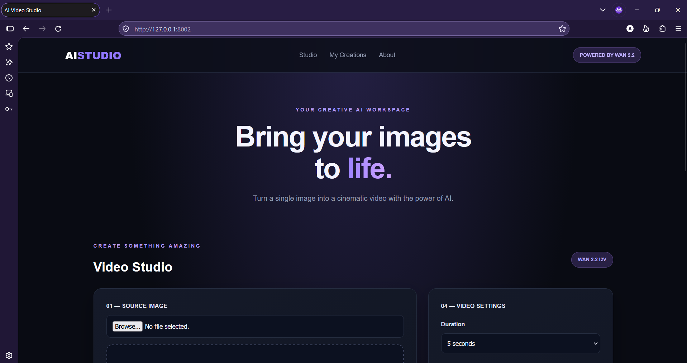
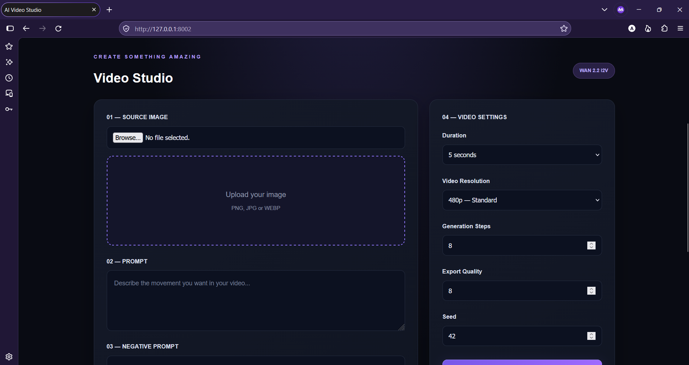
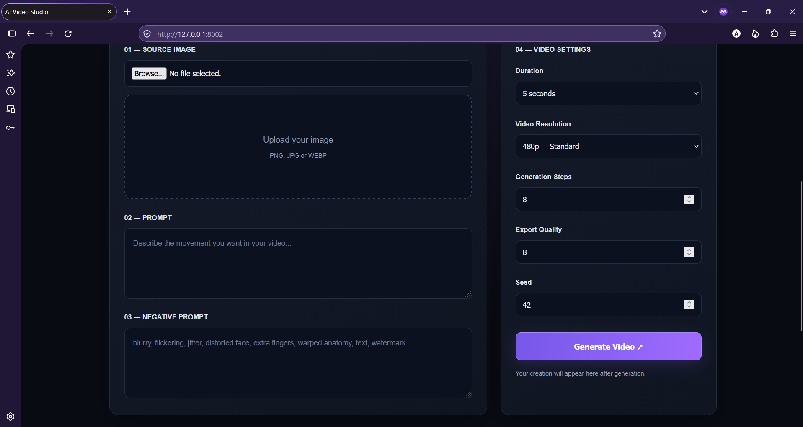
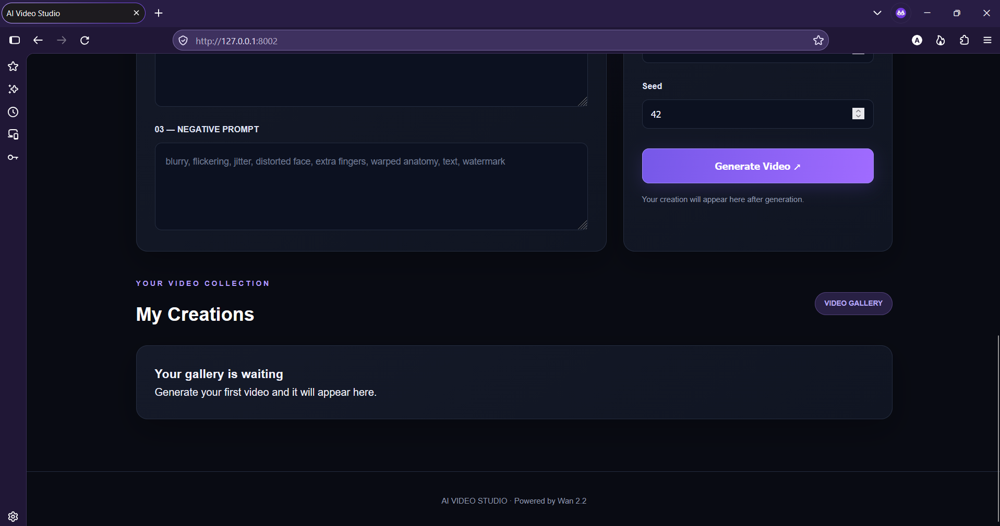

# AI Video Studio

**An AI-powered image-to-video web application using Wan 2.2.**

AI Video Studio transforms static images into animated video clips using the Wan 2.2 image-to-video model hosted on Hugging Face.

## Features

- Upload an image to use as the starting frame.
- Describe the desired animation using a text prompt.
- Configure video duration, inference steps, and seed.
- Add a negative prompt to guide generation.
- Generate videos through a web-based interface.
- Preview and download generated videos.
- View previously generated creations in the gallery.
- Store generated video files locally.

## Technology Stack

| Technology | Purpose |
|---|---|
| Python | Backend programming |
| FastAPI | Web application backend |
| HTML | Application structure |
| CSS | User interface styling |
| JavaScript | Frontend interactions |
| Hugging Face | Hosted AI model |
| Gradio Client | Communication with Wan 2.2 |
| Uvicorn | ASGI server |

## AI Model

This project integrates the **Wan 2.2 14B Image-to-Video** model through the Hugging Face Space:

[Upsampler/Wan 2.2 Image-to-Video](https://huggingface.co/spaces/Upsampler/wan-2-2-14b-image-to-video)

The application sends the uploaded image and generation settings to the hosted model and retrieves the generated video.

## Project Structure

```text
AI-VIDEO-STUDIO/
├── static/
│   ├── style.css
│   └── script.js
├── templates/
│   └── index.html
├── generated_videos/
├── uploads/
├── app.py
├── main.py
├── wan_engine.py
├── requirements.txt
├── .gitignore
└── README.md
```

## Installation

### 1. Clone the repository

```bash
git clone YOUR_GITHUB_REPOSITORY_URL
cd AI-VIDEO-STUDIO
```

### 2. Create a virtual environment

```bash
python -m venv venv
```

### 3. Activate the environment

Windows PowerShell:

```powershell
.\venv\Scripts\Activate.ps1
```

### 4. Install dependencies

```bash
pip install -r requirements.txt
```

### 5. Configure environment variables

Create a `.env` file in the project root:

```env
HF_TOKEN=your_huggingface_token
```

Never publish your actual API tokens or `.env` file.

### 6. Run the application

```bash
python main.py
```

Open:

```text
http://127.0.0.1:8002
```

## Important Notes

- Video generation requires access to the hosted Hugging Face model.
- Generation speed and availability depend on Hugging Face GPU availability and usage quotas.
- Free GPU access may have waiting periods or usage limits.
- This project does not guarantee unlimited free video generation.
- Generated videos are stored locally and are excluded from the Git repository.

## Security

API tokens and private environment variables must remain in `.env`.

The repository uses `.gitignore` to exclude credentials, virtual environments, uploaded files, generated videos, and backup files.

## Project Status

**Functional prototype — under development.**

The project demonstrates integration of a hosted AI image-to-video model with a custom web application interface.

## Future Improvements

- Improve video generation error handling.
- Add generation progress indicators.
- Improve video gallery management.
- Add configurable output resolution when supported by the model.
- Improve model availability and quota handling.

---

**Developed as a personal AI application project.**


---

## 📸 Application Screenshots

### 1. Main Studio


### 2. Image Upload


### 3. Generated Video


### 4. My Creations Gallery


